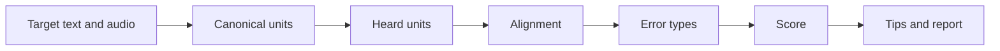
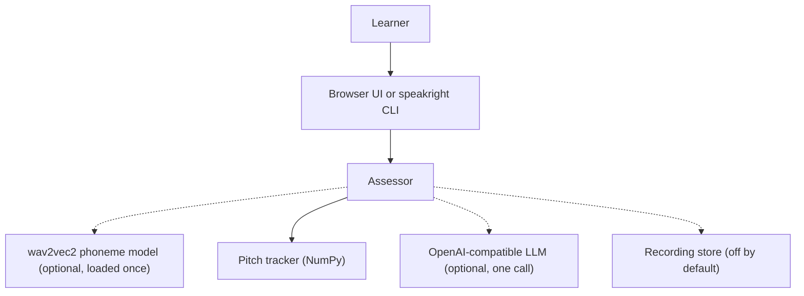
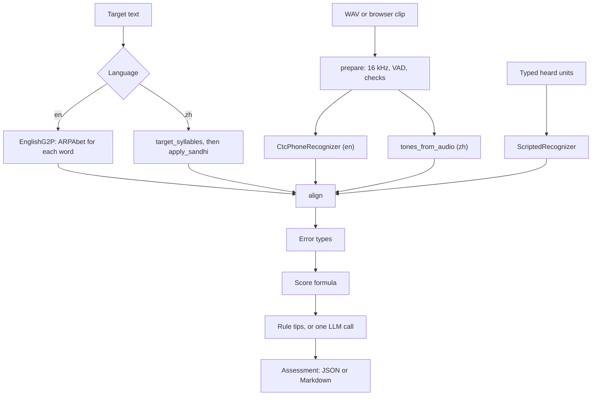

<div align="center">

# speakright — Phone-Level Pronunciation Feedback for English and Mandarin

**speakright is a pronunciation coach for language learners. It takes a target sentence and a recording through these steps to a deterministic score and concrete tips:**

`canonical units` → `phone recogniser` → `alignment` → `error types` → `score` → `tips`.


**[Summary](#1-summary)** ·
**[Workflow](#4-the-end-to-end-workflow)** ·
**[Run it](#10-how-to-run-speakright)** ·
**[Configuration](#104-environment-variables)** ·
**[Known problems](#13-known-problems)** ·
**[Glossary](#15-glossary)**

</div>

> [!NOTE]
> This README uses ASD-STE100 Simplified Technical English. The writing rules and the project
> vocabulary are in [`docs/ste-style-guide.md`](docs/ste-style-guide.md). Each term in the
> [Glossary](#15-glossary) has only one meaning.

---

speakright compares the sounds that a learner said with the canonical sounds of the target. It does not compare words, because a word recogniser changes an accented word into the correct word.
English uses ARPAbet phones from a phone recogniser. Mandarin uses TONE3 pinyin syllables, and the tones come from the pitch of the audio.
A fixed formula gives the score. An optional LLM only rewrites the tips, once, after the score is final.
The offline demo and all tests use simulated learners and synthetic tone audio. They need no model, no key and no network.

This README is the **one location that explains all of speakright**. It gives these topics:

- the general design
- each component and its procedure, step by step
- the decision rules
- the data map
- the runbook
- the validation results and the known problems

| If you are… | Read |
|---|---|
| A manager or reviewer | [1](#1-summary), [3](#3-design-rules), [4](#4-the-end-to-end-workflow), [12](#12-validation-results), [14](#14-key-points) |
| A developer who joins the project | All sections, in sequence. Keep [10](#10-how-to-run-speakright) and [13](#13-known-problems) open while you work |
| An operator who runs speakright | [10](#10-how-to-run-speakright), then the section for the component that you use |

---

## Table of contents

1. 🧭 [Summary](#1-summary)
2. 🏗️ [How speakright is built](#2-how-speakright-is-built)
   - 2.1 [Components](#21-components)
   - 2.2 [System context](#22-system-context)
   - 2.3 [Repository layout](#23-repository-layout)
3. 🛡️ [Design rules](#3-design-rules)
4. 🔄 [The end-to-end workflow](#4-the-end-to-end-workflow)
   - 4.1 [Full flow](#41-full-flow)
   - 4.2 [The life cycle of one assessment](#42-the-life-cycle-of-one-assessment)
5. 🔵 [Canonical units: G2P and pinyin](#5-canonical-units-g2p-and-pinyin)
6. 🟢 [Audio, recognition and pitch](#6-audio-recognition-and-pitch)
7. 🟣 [Alignment, error types and feedback](#7-alignment-error-types-and-feedback)
8. ⚖️ [The decision rules](#8-the-decision-rules)
9. 🗂️ [Data and file map](#9-data-and-file-map)
10. ▶️ [How to run speakright](#10-how-to-run-speakright)
    - 10.1 [Prerequisites](#101-prerequisites) · 10.2 [Installation](#102-installation) · 10.3 [Run speakright](#103-run-speakright) · 10.4 [Environment variables](#104-environment-variables)
11. 🧩 [How to extend speakright](#11-how-to-extend-speakright)
12. ✅ [Validation results](#12-validation-results)
13. ⚠️ [Known problems](#13-known-problems)
14. 📌 [Key points](#14-key-points)
15. 📖 [Glossary](#15-glossary)
16. 📄 [License](#16-license)

---

## 1. Summary

**The problem.** A learner reads a sentence aloud and wants to know which sounds were wrong and how to correct them. These questions are difficult:

- How do you hear the sounds that the learner made, not the words that a language model expects?
- How do you compare two sequences when the learner adds or drops a sound?
- How do you hear a Mandarin tone, and which tone is correct after tone sandhi?
- How do you make a score that is the same for the same input?
- How do you protect voice recordings?

speakright gives each of these questions its own component. Each component has a validated input and a tested output.

| Item | Value |
|---|---|
| Input | A target text (English words, Chinese characters or pinyin), a WAV recording, typed heard units, or both |
| Output | An `Assessment`: canonical and heard units, alignment operations, error list, score 0 to 100, band, tips and notes |
| Components | **14** modules: phones, g2p_en, pinyin, audio, pitch, recognize, align, taxonomy, scoring, llm, assess, simulate, evaluate, privacy (plus config, samples, cli, ui) |
| Recognisers | `CtcPhoneRecognizer` (wav2vec2 phoneme CTC, extra `recognizer`), `ScriptedRecognizer` (typed or simulated units) |
| Offline mode | Typed units, simulated learners, synthetic tone audio, pitch-based tones and rule tips. No key and no network |
| Safety | No recording kept by default, deterministic score, LLM output validated and never used for the score |
| Tests | **46** unit tests (`pytest`): 45 pass locally, 44 pass and 2 skip in CI |



---

## 2. How speakright is built

### 2.1 Components

| Component | Module | Purpose |
|---|---|---|
| Phone set | `src/speakright/phones.py` | ARPAbet set, phone classes, IPA to ARPAbet map |
| English G2P | `src/speakright/g2p_en.py` | CMUdict, built-in lexicon, letter-to-sound rules |
| Mandarin units | `src/speakright/pinyin.py` | TONE3 conversion, character table, traditional to simplified, sandhi, syllable split |
| Audio | `src/speakright/audio.py` | WAV input, 16 kHz resample, energy VAD, audio checks |
| Pitch | `src/speakright/pitch.py` | F0 track, syllable segments, tone rules, synthetic tone audio |
| Recognisers | `src/speakright/recognize.py` | Phone CTC recogniser, scripted recogniser, model cache |
| Alignment | `src/speakright/align.py` | Needleman-Wunsch with phone-class costs, error rate |
| Error types | `src/speakright/taxonomy.py` | 24 named error types and their tips |
| Scores | `src/speakright/scoring.py` | English and Mandarin score formulas, bands |
| LLM tips | `src/speakright/llm.py` | OpenAI-compatible client, reply validation, fake LLM |
| Assessment | `src/speakright/assess.py` | `Assessor`, `Assessment`, Markdown report |
| Simulation | `src/speakright/simulate.py` | Simulated learners, noisy recogniser, old word-level method |
| Evaluation | `src/speakright/evaluate.py` | Detection P, R and F1, Pearson, tone accuracy, speechocean762 loader |
| Privacy | `src/speakright/privacy.py` | Optional recording store with retention and purge |
| Settings | `src/speakright/config.py` | Environment variables and value checks |
| Samples | `src/speakright/samples.py` | 8 English and 10 Mandarin practice sentences |
| CLI | `src/speakright/cli.py` | The `speakright` command with 9 subcommands |
| Browser UI | `src/speakright/ui/streamlit_app.py` | Browser recording with `st.audio_input` (extra `ui`) |

### 2.2 System context



### 2.3 Repository layout

```
speakright/
├── .github/workflows/ci.yml   # CI: Python 3.11, pip install -e ".[dev]", pytest -q
├── .env.example               # 9 environment variable names, no values
├── pyproject.toml             # package, extras recognizer, g2p, llm, ui, dev, the speakright script
├── data/README.md             # corpora, licences, loader layout, recording policy
├── docs/ste-style-guide.md    # writing rules and project vocabulary
├── src/speakright/
│   ├── phones.py  g2p_en.py  pinyin.py         # canonical units
│   ├── audio.py  pitch.py  recognize.py        # audio and heard units
│   ├── align.py  taxonomy.py  scoring.py       # comparison and score
│   ├── llm.py  assess.py                       # tips and the pipeline
│   ├── simulate.py  evaluate.py  privacy.py    # evaluation and recordings
│   ├── config.py  samples.py  cli.py
│   └── ui/streamlit_app.py                     # browser UI
└── tests/                                      # 46 tests, no network, no API keys
```

---

## 3. Design rules

### 3.1 Errors come from the heard phones
The recogniser gives phones, not words. A word recogniser maps an accented word to the correct word, so a word compare misses most errors. The evaluation in section 12 measures this difference.

### 3.2 Both sides use one format
English uses ARPAbet without stress marks on both sides. Mandarin uses TONE3 pinyin on both sides. Characters, traditional characters, diacritic pinyin and TONE3 pinyin all change to the same syllables.

### 3.3 Alignment, not position
`align` uses Needleman-Wunsch with costs from phone classes. One extra sound gives one insertion, and the sounds after it still match.

### 3.4 The score is a formula
`scoring.py` calculates the score from the error rate, the recogniser confidence and the tone accuracy. `Score` refuses a value that is not a float from 0 to 100. The LLM never gives a score.

### 3.5 The LLM is optional and called once
`Assessor` calls the LLM at most one time, after the score is final, and only if there are errors. A missing key, an error or a bad reply keeps the rule tips. Nothing is logged.

### 3.6 Tones come from the audio
For Mandarin, `pitch.py` measures the F0 contour of each syllable and classifies the tone. The expected tones include tone sandhi, so `你好` expects `ni2 hao3`.

### 3.7 No recording is kept by default
`privacy.store` writes nothing unless `SPEAKRIGHT_STORE_AUDIO=yes`. Then it uses random file names and deletes files older than the retention period. The browser records the audio, not the server.

---

## 4. The end-to-end workflow

### 4.1 Full flow



### 4.2 The life cycle of one assessment

1. The learner selects a language and a target text, then records or types the heard units.
2. `prepare` resamples the audio to 16 kHz, trims silence and checks length, level and clipping.
3. For English, the recogniser gives ARPAbet phones with a confidence for each phone.
4. For Mandarin, the heard syllables come from the recogniser or the keyboard, and the tones come from the pitch.
5. The canonical units come from the G2P (English) or from pinyin with sandhi (Mandarin).
6. `align` pairs the two sequences. Each difference becomes an error with a type and a word.
7. The score formula gives a value from 0 to 100 and a band.
8. The tips come from the error types, or from one validated LLM reply.

---

## 5. Canonical units: G2P and pinyin

**Purpose.** Give the expected units of the target text in one canonical format.

| Input | Output |
|---|---|
| English text | `WordPhones` for each word: phones, source, `approximate` flag |
| Characters or pinyin | TONE3 syllables, before and after sandhi |

**Procedure**

1. `EnglishG2P.word` looks in CMUdict first, then in the built-in lexicon of 62 words.
2. If no lexicon has the word, letter-to-sound rules give phones with `approximate=True`, and the report adds a note.
3. `target_syllables` uses pypinyin if it is installed, otherwise the built-in table with 5 words and 39 characters.
4. Before the lookup, the code removes punctuation and changes 13 traditional characters to simplified characters.
5. `to_tone3` changes a tone mark to a number: `nǐ` becomes `ni3`, `lǜ` becomes `lv4`, no mark gives tone 5.
6. `apply_sandhi` changes 不 to `bu2` before tone 4, 一 to `yi2` before tone 4 and to `yi4` before tones 1 to 3, and 3-3 to 2-3.

---

## 6. Audio, recognition and pitch

**Purpose.** Change a recording into heard units and Mandarin tones.

| Input | Output |
|---|---|
| WAV bytes or file (PCM 8, 16 or 32 bit, any rate, mono or stereo) | 16 kHz float samples and an `AudioCheck` |
| 16 kHz samples | `Recognition`: units, confidences, dropped symbols |
| 16 kHz samples and a syllable count | One `ToneResult` for each syllable |

**Procedure**

1. `read_wav` reads the PCM data with the standard `wave` module and averages the channels.
2. `to_16k` resamples with a polyphase filter. `vad_trim` removes frames 30 dB below the loudest frame.
3. `check` refuses audio shorter than 0.3 s, longer than 30 s, quieter than -45 dBFS or with more than 1% clipped samples.
4. `CtcPhoneRecognizer` runs a wav2vec2 phoneme CTC model, decodes the best path and maps IPA symbols to ARPAbet.
5. The confidence of a phone is the mean top-class posterior over its frames.
6. `f0_track` finds the autocorrelation peak from 70 to 400 Hz in 40 ms frames with a 10 ms hop.
7. `segment_syllables` uses voiced runs. If the count is wrong, it cuts the voiced span into equal parts.
8. `classify_tone` changes the contour to semitones against the speaker median and applies the tone rules in section 8.

---

## 7. Alignment, error types and feedback

**Purpose.** Find each difference, give it a name and a tip, and calculate the score.

| Input | Output |
|---|---|
| Canonical and heard units | Alignment operations, `ErrorItem` list, `Score`, tips |

**Procedure**

1. `align` fills the dynamic-programming table with substitution costs from section 8 and a gap cost of 1.
2. The trace-back gives `match`, `sub`, `del` and `ins` operations in order.
3. `classify_english` names each English operation, for example `th-stopping` for `TH` heard as `T`.
4. For Mandarin, the code compares the initial, the final and the tone of each aligned syllable.
5. The score formula in section 8 gives the value and the band.
6. `rule_tips` gives one tip for each error type, maximum 5. If an LLM is configured and there are errors, one call can replace them.

**Error types**

| Language | Types |
|---|---|
| English | `th-stopping`, `th-fronting`, `r-l-confusion`, `v-w-confusion`, `v-b-confusion`, `vowel-length`, `final-devoicing`, `sh-s-confusion`, `n-ng-confusion`, `final-consonant-deletion`, `vowel-epenthesis`, `phone-deletion`, `phone-insertion`, `substitution` |
| Mandarin | `retroflex-loss`, `retroflex-added`, `n-l-confusion`, `palatal-confusion`, `final-error`, `tone-error`, `tone-3-as-2`, `tone-2-as-3`, `syllable-deletion`, `syllable-insertion` |

---

## 8. The decision rules

**Scores**

| Language | Formula |
|---|---|
| English, with confidences | `100 x (0.8 x (1 - min(1, PER)) + 0.2 x mean confidence of matched phones)` |
| English, without confidences | `100 x (1 - min(1, PER))` |
| Mandarin | `100 x (0.6 x (1 - min(1, syllable error rate)) + 0.4 x tone accuracy)` |

| Band | Score |
|---|---|
| `excellent` | 90 or more |
| `good` | 75 to 89.9 |
| `fair` | 50 to 74.9 |
| `needs practice` | Below 50 |

**Alignment costs**

| Pair | Cost |
|---|---|
| Same phone | 0 |
| Same phone class (for example `TH` and `S`) | 0.8 |
| Different consonant classes | 1.0 |
| Vowel and consonant | 1.6 |
| Insertion or deletion | 1.0 |
| Mandarin syllables | 0.5 for a different initial + 0.5 for a different final (the tone is compared after the alignment) |

**Tone rules (semitones against the speaker median, contour reduced to 10 points)**

| Tone | Rule |
|---|---|
| 3 | The minimum is at 20% to 80% of the syllable, and the start and the end are both more than 1.5 above it |
| 2 | Otherwise, end - start > 2.5 |
| 4 | Otherwise, end - start < -2.5 |
| 1 | Otherwise, the mean is above -1.5 |
| 3 | Otherwise (a low, level contour) |

The neutral tone (5) is not scored.

**LLM reply**

| Rule | Value |
|---|---|
| Format | JSON `{"tips": [...]}` |
| Tips | 1 to 5 strings, each 1 to 240 characters |
| Calls | At most 1 for each assessment, only with errors |

---

## 9. Data and file map

| Path | Committed? | Contents |
|---|---|---|
| `data/README.md` | Yes | Corpora, licences, loader layout, recording policy |
| `data/*` | No (git ignores it) | Downloaded corpora |
| `.env.example` | Yes | Variable names, no values |
| `.env` | No (git ignores it) | Local settings and the LLM key |
| `artifacts/audio/rec-<random>.wav` | No (git ignores it) | Stored recordings, only with `SPEAKRIGHT_STORE_AUDIO=yes` |
| `artifacts/demo/demo_summary.json` | No (git ignores it) | Demo examples and the synthetic evaluation |
| `*.wav`, `*.mp3`, `*.flac`, `*.ogg`, `*.m4a`, `*.webm` | No (git ignores them) | Any audio file |
| Hugging Face cache | Not in the repository | The wav2vec2 model, after the first use |

---

## 10. How to run speakright

### 10.1 Prerequisites

| Need | For |
|---|---|
| Python 3.11+ | All components (CI uses 3.11) |
| `numpy`, `scipy` | Core (installed with the package) |
| Extra `recognizer` (`torch`, `transformers`) | Phone recognition from English audio |
| Extra `g2p` (`cmudict`, `pypinyin`) | Any English word and any Chinese text |
| Extra `llm` (`httpx`) | LLM tips |
| Extra `ui` (`streamlit`) | The browser UI |

### 10.2 Installation

```bash
git clone https://github.com/KrishnaAnnavaram/speakright.git
cd speakright
python -m venv .venv
. .venv/bin/activate            # Windows: .venv\Scripts\activate
pip install -e ".[dev]"         # add ,recognizer or ,g2p or ,llm or ,ui when you need them
cp .env.example .env            # optional: empty values keep the defaults
```

### 10.3 Run speakright

Offline (no model, no key, no network):

```bash
speakright demo --out artifacts/demo
speakright samples --lang en
speakright g2p "this ship is not a sheep"
speakright g2p "我很好" --lang zh
speakright assess --text "this ship" --phones "D IH S S IH P"
speakright synth-tones --pinyin "ni3 hao3" --out artifacts/nihao.wav
speakright assess --text "你好" --lang zh --phones "ni hao" --audio artifacts/nihao.wav
speakright tones --audio artifacts/nihao.wav --syllables 2
speakright eval --n 200
speakright purge --days 7
```

With the real recogniser, the LLM and the browser UI:

```bash
pip install -e ".[recognizer,g2p,llm,ui]"
speakright assess --text "three thin thieves" --audio my_recording.wav
speakright eval --speechocean data/speechocean762 --limit 500
speakright ui                                   # http://localhost:8501
```

### 10.4 Environment variables

| Variable | Used by | Meaning |
|---|---|---|
| `SPEAKRIGHT_RECOGNIZER_MODEL` | Recogniser | Hugging Face model ID. Default `facebook/wav2vec2-lv-60-espeak-cv-ft` |
| `SPEAKRIGHT_DEVICE` | Recogniser | `cpu` (default) or a torch device |
| `SPEAKRIGHT_LLM_BASE_URL` | LLM tips | Chat-completions base URL, for example a DeepSeek, OpenAI or local server. Empty: no LLM |
| `SPEAKRIGHT_LLM_API_KEY` | LLM tips | API key. Empty for a local server |
| `SPEAKRIGHT_LLM_MODEL` | LLM tips | Model name. Empty: no LLM |
| `SPEAKRIGHT_STORE_AUDIO` | Privacy | `no` (default) or `yes` |
| `SPEAKRIGHT_AUDIO_DIR` | Privacy | Recording folder. Default `artifacts/audio` |
| `SPEAKRIGHT_RETENTION_DAYS` | Privacy | Days before a recording is deleted. Default `7` |
| `SPEAKRIGHT_CMUDICT` | English G2P | Path to a CMUdict text file (optional) |

A bad value stops the command with `error:`.
Credentials are only in a local `.env` file. Git ignores this file. Do not print or commit credentials.

---

## 11. How to extend speakright

| You want to… | Do this | Code change? |
|---|---|---|
| Use a different phoneme model | Set `SPEAKRIGHT_RECOGNIZER_MODEL`. Add IPA symbols to `IPA_TO_ARPA` if reports show dropped symbols | No / Small |
| Add a practice sentence | Add it to `samples.py`. Add missing words to `BUILTIN_LEXICON` or install the extra `g2p` | Small |
| Add an error type | Add a pair to `EN_SUBS` or `ZH_INITIALS` and a tip to `TIPS` | Small |
| Change the score weights | Change the formulas in `scoring.py` and the tests | Small |
| Add a Mandarin syllable recogniser | Write a class with `recognize(x, sr)` that returns TONE3 syllables | Yes |
| Add a corpus | Write a loader that returns `OceanItem` records | Small |

Planned milestones (not built):

- **M5:** run `eval --speechocean` with the default model and publish the measured numbers.
- **M6:** a Mandarin syllable recogniser and an evaluation on a tone corpus.
- **M7:** a trained tone classifier that replaces the fixed rules.

---

## 12. Validation results

| Validation | Result | Command |
|---|---|---|
| Unit tests (local, with Streamlit) | **45 passed, 1 skipped** (pypinyin not installed) | `pytest -q` |
| Unit tests (CI simulation, clean venv, `.[dev]` only) | **44 passed, 2 skipped** | `pip install -e ".[dev]"`, `pytest -q` |
| English phone-error detection, 200 simulated utterances | Precision 0.781, recall 0.969, F1 **0.865** | `speakright demo` |
| English word-level detection, speakright | Precision 0.812, recall 1.000, F1 **0.896** | `speakright demo` |
| English word-level detection, old word method | Precision 1.000, recall 0.141, F1 **0.248** | `speakright demo` |
| Score against the synthetic human score | Pearson **0.875** | `speakright demo` |
| Mandarin tones from audio, 100 utterances, clear contours | Tone accuracy **0.990**, tone-error F1 0.994 | `speakright demo` |
| Mandarin tones, flat speech (half pitch range, more noise) | Tone accuracy **0.700**, tone-error F1 0.670 | `speakright demo` |

All numbers in this table are SYNTHETIC. The learners, the recogniser noise (5%) and the "human" scores come from `simulate.py` with seed 0.
The word-method rows show why the old design failed. Its language model returned the correct word for 85% of mispronounced words. Thus it found only 14% of the bad words.
The tone audio is hummed, not speech. The flat-speech row shows that the tone rules fail when the pitch movement is small: tone 2 is often heard as tone 1.
No number on real learner speech is reproduced here. The speechocean762 command exists, but its result is not measured yet (milestone M5).

---

## 13. Known problems

Read these problems before you use speakright in production.

| # | Area | Problem | Impact and action |
|---|---|---|---|
| 1 | Evaluation | No result on real speech is in this repository or in CI | Run `speakright eval --speechocean` before you trust a score |
| 2 | Recogniser | A phoneme model has its own errors, and its IPA set is larger than ARPAbet | Check the `dropped` note. Extend `IPA_TO_ARPA` |
| 3 | Mandarin | No Mandarin syllable recogniser is included. The heard syllables come from the keyboard or a custom recogniser | Only the tones come from the audio |
| 4 | Tones | The tone rules are fixed and fail on flat speech (0.70 tone accuracy in the synthetic flat-speech test) | Use the tone result as a hint. A trained classifier is planned (M7) |
| 5 | Tones | Syllable segments come from voiced runs. Joined syllables are cut into equal parts | Pause a little between syllables when you practise tones |
| 6 | G2P | Without CMUdict, words outside the 62-word lexicon use rough rules | Install the extra `g2p`. The report marks approximate words |
| 7 | Accents | The canonical form is one General American pronunciation | A correct British or other accent can show errors |
| 8 | Score | The weights 0.8 / 0.2 and 0.6 / 0.4 are not fitted to human scores | Fit them on speechocean762 (M5) |
| 9 | UI | The browser UI needs Streamlit 1.39 or later for `st.audio_input` | Use the CLI with a WAV file on older versions |

**Responsible use.** speakright is a practice tool. It is not a test of language ability, and it must not be used for admission, hiring or grading decisions. A teacher must check the feedback. Phone models are trained on some accents more than others, so the error rate can be higher for some speakers. Voice recordings are personal data: keep `SPEAKRIGHT_STORE_AUDIO=no` unless the learner agrees.

---

## 14. Key points

1. **Errors come from phones, not words.** The synthetic test shows recall 1.00 against 0.14 for the old word method.
2. **One format on both sides.** ARPAbet for English and TONE3 pinyin with sandhi for Mandarin.
3. **Alignment, not position.** One extra sound gives one error, not a chain of errors.
4. **The score is a formula.** The same input gives the same score, and the LLM never changes it.
5. **Tones come from the pitch.** The tone of a Mandarin syllable is measured in the audio.
6. **No recording is kept by default.** Storage is opt-in, with random names and a retention period.

---

## 15. Glossary

| Term | Meaning |
|---|---|
| **ARPAbet** | The set of 39 English phone symbols that speakright uses, without stress marks |
| **Alignment** | The pairing of canonical units and heard units with match, substitution, deletion and insertion |
| **Assessment** | The result for one utterance: units, alignment, errors, score, tips and notes |
| **Canonical units** | The expected phones or syllables of the target text |
| **Confidence** | The mean top-class posterior of a recognised phone, from 0 to 1 |
| **Error type** | A named kind of error, for example `th-stopping` |
| **F0** | The fundamental frequency of the voice, in Hz |
| **G2P** | Grapheme-to-phoneme: the change from written words to phones |
| **Heard units** | The phones or syllables that the recogniser or the user gives |
| **PER** | Phone error rate: (substitutions + deletions + insertions) / canonical phones |
| **Phone** | One speech sound, as an ARPAbet symbol |
| **Recogniser** | A component that changes audio into heard units |
| **Sandhi** | A tone change caused by the next syllable, for example 3-3 to 2-3 |
| **Target** | The text that the learner reads aloud |
| **TONE3** | Pinyin with the tone as a final digit 1 to 5 (5 is the neutral tone) |
| **Tone accuracy** | The fraction of scored syllables whose heard tone equals the expected tone |

---

## 16. License

[MIT](LICENSE) © 2026 Krishna Annavaram
